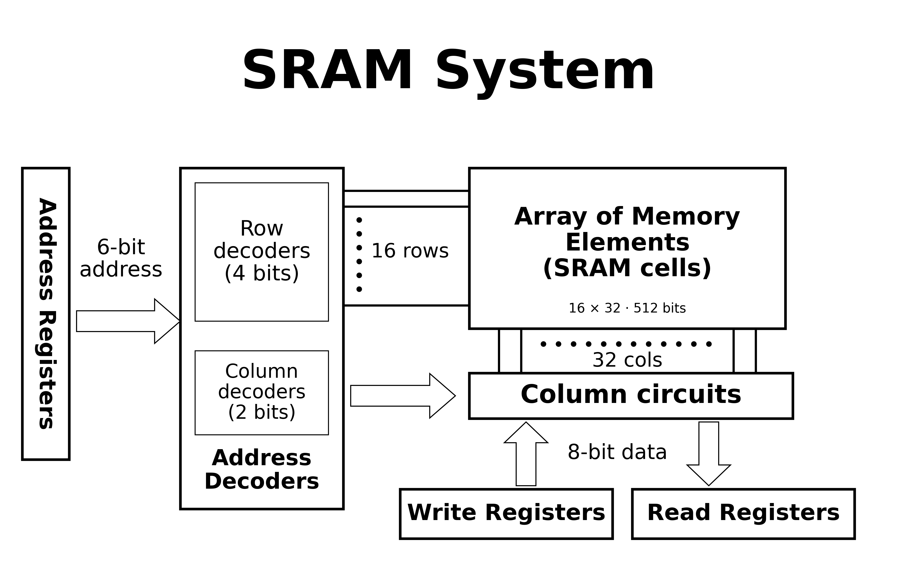
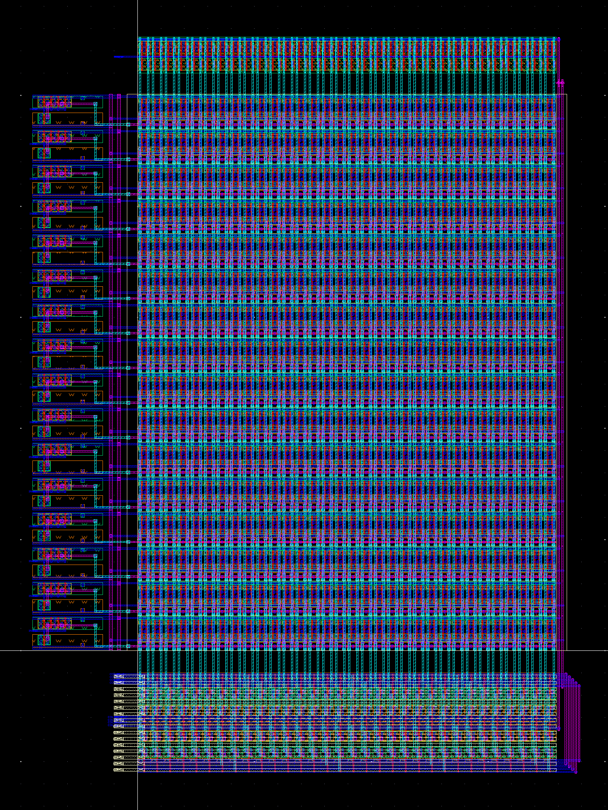
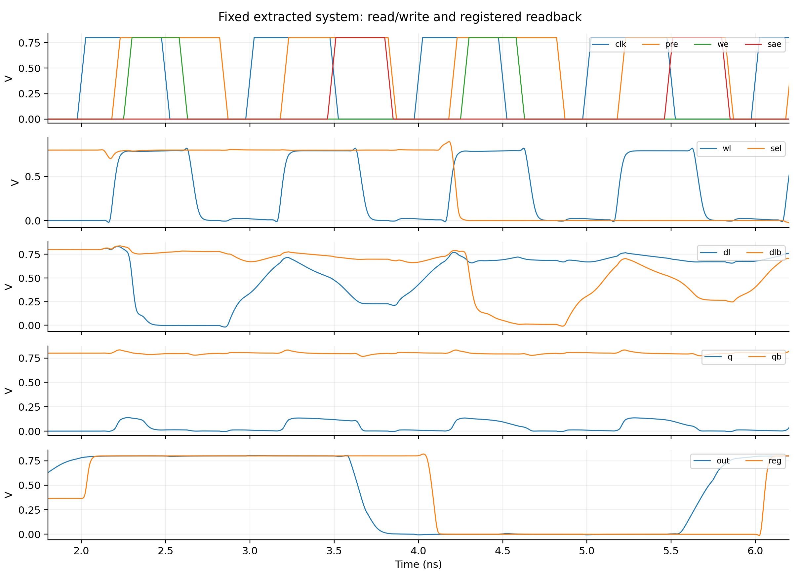
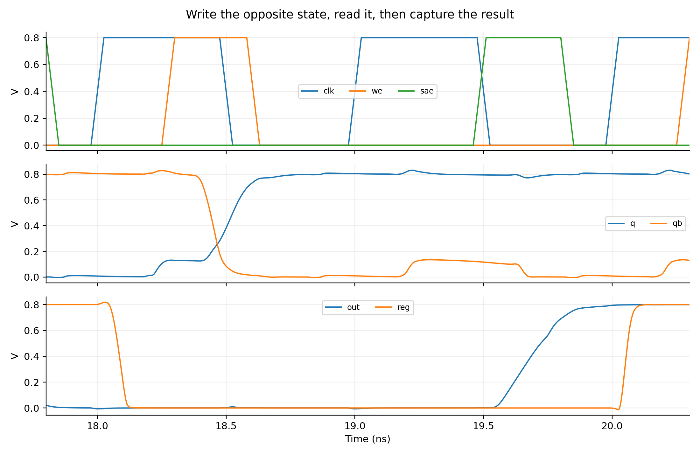
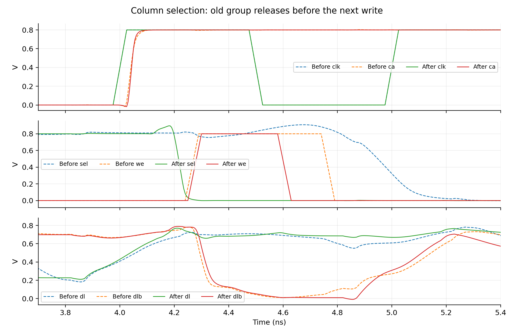
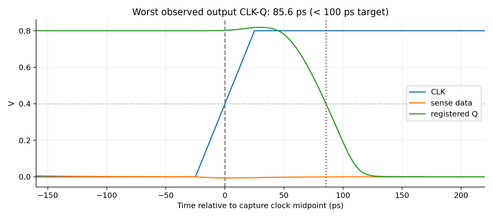

# 512-bit SRAM

A transistor-level **512-bit SRAM**, organized as a **16 × 32 bitcell array** with a **64-word × 8-bit interface**, designed using FreePDK45. The system combines a physical SRAM core with schematic address/data registers, row and column decoders, write circuitry, and sense amplifiers.

This team project showcase focuses on layout integration, DRC/LVS verification, parasitic extraction, schematic timing improvements, and mixed schematic/extracted system validation. The physical core includes the bitcells, precharge devices, column transmission gates, and final wordline inverters. Cadence Virtuoso, Calibre, and HSPICE were used for design and verification.

## System overview

## Integrated layout

The physical core is DRC-clean and LVS-correct. Its footprint is **777.42 µm²**, with **57.72% bitcell area efficiency**; the schematic-only peripherals are excluded from this area.

## Nominal simulation results

The extracted core and schematic peripherals pass **256 operations across all 64 addresses and 512 cells**, with **zero failures in 13,568 checks**. Tests use both checkerboard polarities, immediate write/readback, and final cell-retention checks across eight independent two-row cases.

Conditions: **0.8 V, 25 °C, 1 ns clock period, 50 ps source edges**. Sense outputs have 10 fF explicit load plus register input load; registered outputs have 10 fF load.

| Measurement | Extracted system |
|---|---:|
| Clock-to-column selection | 221 ps |
| Clock-to-far-end wordline rise, row 0 | 216 ps |
| Clock-to-valid sense data | 765 ps |
| Output register clock-to-Q | 85.6 ps |
| Representative falling cell node to VDD/2 during write | 450 ps |
| Average main-supply power, representative sequence | 381 µW |

The output register captures on the next rising edge: registered read latency is approximately **1.086 ns**, while the tested clock period is **1 ns**. These are nominal simulation results, not fabricated-silicon measurements.

## Read and write waveforms

`q` and `qb` show one representative storage cell; `out` is the sense output and `reg` is the registered read output. Other controls and selected data lines are shown alongside the clock.

An opposite-state write, immediate read, and subsequent output-register capture:

## Timing improvements

Tapered column-select buffers and resized decoder stages reduced the representative column transition from **979 ps to 221 ps**, preventing the previous column from remaining selected during a later write. Register sizing reduced observed clock-to-Q from **117 ps to 85.6 ps**.

## Scope and remaining qualification

Clock and control waveforms are external testbench sources. The functional pass does not establish PVT, mismatch, or static noise-margin qualification. A controlled 500 ps write-low sweep succeeds at a 0.200 V data-line floor and fails at 0.225 V; this does not demonstrate the >30% VDD cell write-margin target. Isolated selected-data-line recovery to 95% VDD is approximately 470 ps, longer than the normal observed precharge interval, so full-rail precharge is not claimed.

## Design and simulation files

| Directory | Contents |
|---|---|
| `library/ece6130_library/` | Updated editable Cadence library: **109 OA views**, including `SRAM_SYSTEM`, buffered column decoder, registers, and physical core |
| `netlists/` | Full schematic system, native system bound to PEX, and schematic core netlists |
| `pex/` | Extracted core netlist and both required RC sidecars |
| `simulation/` | **37 cases**: representative PEX/schematic runs, native-top smoke test, eight coverage cases, register tests, write-limit and precharge experiments |
| `results/` | Recorded summaries, raw `.mt0` measurement tables, expected checks, and waveform CSVs |
| `scripts/` | Cadence setup helper |
| `images/` | Selected layout, architecture and waveform figures |

